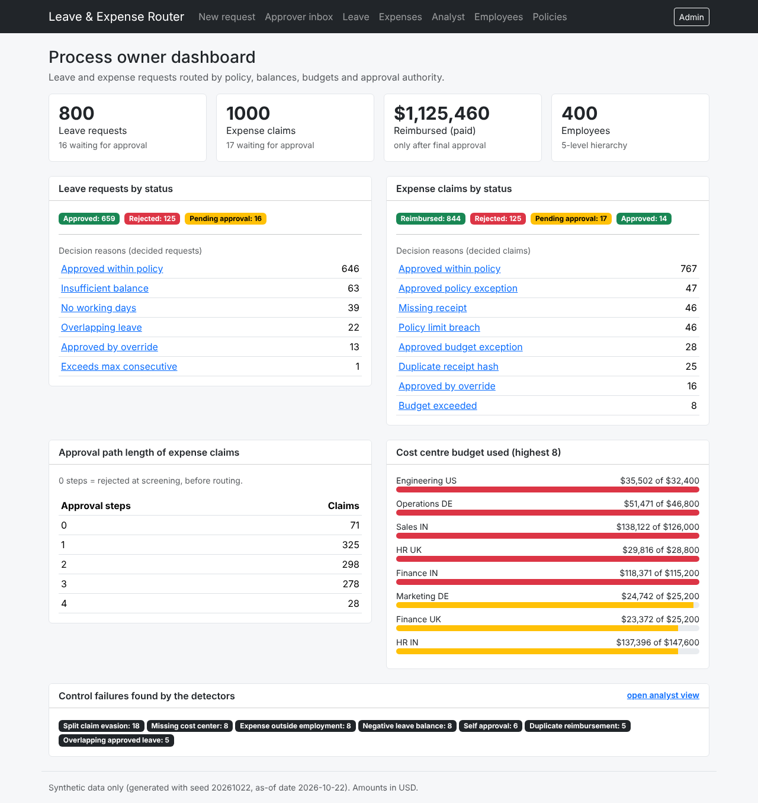

# Leave & Expense Router

A working solution for the **Code Challenge – Route leave and expense requests using policy, balances, budgets and approval authority.**

It has three parts that share one set of business rules:

1. **A seeded data generator** that builds a realistic synthetic company (400 employees, 800 leave requests, 1,000 expense claims) with planted, labelled edge cases and a separate answer key.
2. **Validation, audit and reproducibility scripts** that prove the data is consistent and the rules were applied.
3. **A Django + MySQL web application** (Bootstrap + JavaScript front end) where requesters submit, the router screens and routes, approvers decide, and reimbursements are created only after final approval.

| Layer | Technology |
|---|---|
| Front end | HTML, CSS, JavaScript, Bootstrap 5.3 (vendored locally, works offline) |
| Back end | Python, Django |
| Database | MySQL (tested on MariaDB 10.11, which is MySQL compatible) and plain SQL |



---

## 1. Quick start

You need Python 3.10+ and a running MySQL 8 server.

```bash
# 1. install the three packages
pip install -r requirements.txt

# 2. create an empty database and a user (run in the mysql client)
#    CREATE DATABASE leave_expense_router CHARACTER SET utf8mb4;

# 3. tell Django how to connect  (Windows: use "set NAME=value" instead of export)
export DB_NAME=leave_expense_router DB_USER=root DB_PASSWORD=your_password

# 4. create Django's own tables, then our 15 tables, and load the data
python manage.py migrate
python manage.py load_data

# 5. start the site
python manage.py runserver          # open http://127.0.0.1:8000
```

Optional: `python manage.py createsuperuser` to log in to `/admin/` (the system administrator's screen).

### Regenerate and verify the data (no database needed)

```bash
python -m generator.generate_data              # writes ./data  (CSV, JSON, SQL, manifest)
python validate_data.py                        # 91 structural checks   -> docs/validation_summary.md
python audit_rules.py                          # 10 business-rule checks -> docs/audit_report.md, docs/metrics.json
python check_reproducibility.py                # same seed twice = identical checksums
python smoke_test.py                           # 38 checks against the running app's code (needs the database)
python -m generator.generate_data --scale 0.25 --out data_starter   # a smaller dataset from the same generator
```

---

## 2. The workflow, end to end

```
 MASTER DATA              REQUEST                 SCREENING              ROUTING                 APPROVAL                OUTCOME
 employees, hierarchy ->  leave request       ->  business days      ->  approval_rules      ->  step 1 (PENDING)    ->  APPROVED
 cost centres, budgets    (dates, type)           balance enough?        pick the roles          step 2 (WAITING)        REJECTED
 leave + expense          expense claim           overlap?               resolve each person     ...                     (every change is
 policies, rules          (1-10 lines,            receipt present?       from the hierarchy      one decision at         a new row in
                          receipts)               duplicate receipt?     skip duplicates         a time                  status_events)
                                                  inside employment?
                                                  cost centre present?                                                   claim APPROVED
                                                                                                                         -> reimbursement
                                                  fail -> REJECTED here                                                  (only now)
                                                  (no approvers needed)
```

### Lifecycle states

| Object | States |
|---|---|
| Leave request | `SUBMITTED → PENDING_APPROVAL → APPROVED / REJECTED`, or `SUBMITTED → REJECTED` (failed screening) |
| Expense claim | same, plus `APPROVED → REIMBURSED` once the payment date has passed |
| Approval step | `WAITING → PENDING → APPROVED / REJECTED`; steps after a rejection are `SKIPPED` |
| Reimbursement | `SCHEDULED → PAID` |

Nothing is overwritten silently: every status change is appended to `status_events` (who, when, from, to, reason code).

### Screening rules (stop a request before it reaches an approver)

| Domain | Check | Result if it fails |
|---|---|---|
| Leave | request has 0 business days (weekend / holiday only) | `NO_WORKING_DAYS` |
| Leave | overlaps another approved or pending request of the same person | `OVERLAPPING_LEAVE` |
| Leave | business days > available balance (equal is allowed) | `INSUFFICIENT_BALANCE` |
| Leave | business days > policy maximum in a row | `EXCEEDS_MAX_CONSECUTIVE` |
| Expense | no cost centre | `MISSING_COST_CENTER` |
| Expense | a line is dated before hire or after termination | `EXPENSE_OUTSIDE_EMPLOYMENT` |
| Expense | a line above the "receipt required above" amount has no receipt | `MISSING_RECEIPT` |
| Expense | a receipt fingerprint (hash) was already used on another line | `DUPLICATE_RECEIPT_HASH` |

If several checks fail, the first one in this order is the recorded reason, and every failed check is labelled in the ground truth.

### Routing rules (who must approve) – stored as data in `approval_rules`

| Rule | Applies to | Approver role added |
|---|---|---|
| APRL-L1 | every leave request | direct **manager** |
| APRL-L2 | leave over 3 business days | **manager's manager** (skip level) |
| APRL-L3 / L4 | leave over 10 business days, or any unpaid leave | **HR head** |
| APRL-E1 | every expense claim | direct **manager** |
| APRL-E2 | claim total over 500 USD | **manager's manager** |
| APRL-E3 | any client-entertainment line | **manager's manager** |
| APRL-E4 | claim total over 2,000 USD | **finance controller** |
| APRL-E5 | any line above its policy limit | **finance controller** (exception path) |
| APRL-E6 | DE / UK claims over 1,000 USD | **finance controller** (regional review) |
| APRL-E7 | claim total over 10,000 USD | **CFO** |
| APRL-E8 | claim pushes its cost centre over budget | **CFO** |

A role appears once in a path and is tied to the first rule that required it. The order is always manager → skip manager → finance controller → HR head → CFO. If the same person would approve twice (for example a director whose manager is the CFO), the later step is recorded as `SKIPPED` with reason `SAME_APPROVER_EARLIER_STEP`.

### Exception paths (decisions inside the approval chain)

* **Policy exception:** a line up to **120 %** of its limit is approved by the finance controller as `APPROVED_POLICY_EXCEPTION`; above 120 % the finance controller rejects (`POLICY_LIMIT_BREACH`) and the remaining steps are skipped.
* **Budget exception:** if approving a claim would push its cost centre over its annual budget, the CFO must decide. Up to **10 %** over budget → `APPROVED_BUDGET_EXCEPTION`; more than 10 % → rejected (`BUDGET_EXCEEDED`). "Budget used" means the total of **approved** claims of that cost centre.
* **Reimbursement:** a `reimbursements` row is created only after the last step approves. It is `SCHEDULED` until its payment date passes, then `PAID` (and the claim becomes `REIMBURSED`).

### Derived values (never generated independently)

* `business_days` = weekdays in the range minus the country's public holidays.
* Leave accrual: credited on the 1st of every month the person is employed, `min(annual_days, per_month × months)`. Available = opening + accrued − used − pending. Used and pending are sums over the requests.
* Claim `total_amount` = sum of its lines; `line_count` = number of lines; `has_policy_breach` and `budget_exceeded` come from the lines and the running cost-centre spend.
* Every outcome comes from `generator/rules.py`, not from a random draw. Randomness only chooses *inputs* (dates, amounts, who asks) and the 1–3 day turnaround of each step.

---

## 3. Data model

Full field-by-field data dictionary (type, required, allowed values, unit, uniqueness, validation rule): **[docs/data_dictionary.md](docs/data_dictionary.md)** – it is generated from `generator/schema_spec.py`, the same file that produces `sql/schema.sql` and drives the validator, so the three cannot drift apart.

| Entity | Key | Relationships |
|---|---|---|
| `employees` | `EMP-000001` | `manager_id` → employees (1:N, empty only for the CEO); `cost_center_id` → cost_centers |
| `cost_centers` | `CC-001` | 1:N employees, 1:N claims (optional on a claim so the missing-cost-centre case can be stored) |
| `leave_policies` | `LPOL-01` | 6 policies; one policy can cover several countries (`UK\|DE`) |
| `leave_balances` | `LBAL-2026-000001` | **bridge** employees ↔ leave_policies (N:M), one row per employee, policy and year |
| `leave_requests` | `LVE-2026-000001` | employee N:1, policy N:1 |
| `expense_policies` | `EPOL-01` | one per category (limit + receipt rule) |
| `expense_claims` | `EXP-2026-000001` | employee N:1, cost centre N:1 (optional) |
| `expense_lines` | `EXPL-EXP-2026-000001-01` | claim 1:N (1 to 10 lines), policy N:1 |
| `approval_rules` | `APRL-E2` | data-driven routing; effective-dated (`effective_from/to`) |
| `approval_steps` | `APR-EXP-2026-000001-01` | **bridge** request ↔ rule ↔ approver; exactly one of leave / expense (enforced by a CHECK) |
| `reimbursements` | `RMB-2026-000001` | claim 1:0..1 (more than one only for the planted duplicate-payment case) |
| `status_events` | `EVT-000001` | append-only history, 1:N per request |
| `ground_truth` | `GT-000001` | answer key, **not an input table** |
| `detected_exceptions` | `DET-000001` | output of the detectors |

IDs are zero padded, never reused, and referenced identically everywhere. All foreign keys are real constraints in `sql/schema.sql` (InnoDB).

---

## 4. How the data is generated (the 10 steps)

| Step | What | Where |
|---|---|---|
| 1 | Data dictionary | `generator/schema_spec.py` → `docs/data_dictionary.md` |
| 2 | Parents first, then children and events | `masters.py` → `leave_flow.py` / `expense_flow.py` → `generate_data.py` |
| 3 | Deterministic IDs | `generator/helpers.py` |
| 4 | Baseline volume, fixed seed **20261022**, `--scale` for starter or full | `generate_data.py`, `config.py` |
| 5 | Valid baseline first, then labelled edge cases | injections in `generate_data.py` / `expense_flow.py` |
| 6 | Derived values calculated from source records | `rules.py`, `leave_flow.build_balances` |
| 7 | Separate `ground_truth.csv/json` | `build_ground_truth` (never read by decision code) |
| 8 | Validation | `validate_data.py`, `audit_rules.py` |
| 9 | Export CSV, JSON, SQL, README, dictionary, command, seed, source manifest, validation summary | `data/`, `docs/` |
| 10 | Regenerate twice, compare counts and checksums | `check_reproducibility.py` → `docs/reproducibility.txt` |

**Volumes (default scale):** 400 employees · 6 leave policies · 800 leave requests · 1,000 expense claims with 3,121 lines (1 to 10 per claim) · 1,200 leave balances · 2,815 approval steps · 863 reimbursements · 6,015 status events.

### Edge cases

*Baseline cases* come out of the normal rules (the data is generated with natural rates, e.g. 4 % of lines are made a policy breach on purpose):

| Case | Count |
|---|---|
| Insufficient leave balance | 68 labelled (63 rejected as the first reason) |
| Overlapping leave (rejected) | 24 |
| Weekend / holiday spans | 246 requests; 39 had no working day at all |
| Missing receipt | 46 |
| Duplicate receipt hash | 25 |
| Policy limit breach | 116 claims (47 approved as exception, 46 rejected) |
| Budget exceeded | 52 claims (28 approved as exception, 8 rejected) |
| Multi-level approval (3+ steps) | 352 |
| Boundary totals exactly on 500 / 2,000 / 10,000 | 6 |

*Planted anomalies* – a control failed on purpose and the record carries a label in `ground_truth` (they are approved "by override", approved by the requester, paid twice, and so on):

| Anomaly | Count | How it is planted |
|---|---|---|
| Negative leave balance | 8 | a request that failed only the balance check is approved anyway |
| Overlapping approved leave | 5 | a request that failed only the overlap check is approved anyway |
| Expense date outside employment | 8 | line dated before hire (5) or after termination (3) |
| Split claims to evade a threshold | 18 claims in 6 groups of 3 | three claims of 440–499 USD, same person, same purpose, within days |
| Missing cost centre | 8 | cost centre removed, approved anyway |
| Approval by requester | 6 | 3 leave requests + 3 claims: step 1 approver replaced by the requester |
| Duplicate reimbursement | 5 | a paid claim is paid a second time |

---

## 5. Results

| Check | Result |
|---|---|
| Structural validation (keys, foreign keys, enums, types, patterns, date order, arithmetic, lifecycle, duplicates) | **91 / 91** passed |
| Business-rule audit (decisions, routing paths, approvers, reimbursements recomputed from source rows) | **10 / 10** passed |
| Planted anomalies found by the detectors | **58 / 58**, precision 1.0, recall 1.0 for every type |
| Reproducibility | same seed twice → identical row counts and SHA-256 for all 15 files; a different seed changes 11 of 15 |
| Starter scales (0.1 and 0.25) | pass the same validation and audit |
| App smoke test | **38 / 38** (all pages open; submit → approve → balance update → reimbursement; guards) |

Business metrics (from `docs/metrics.json`): leave approval rate of decided requests 84.1 %, expense approval rate 87.3 %; 1.48 M USD submitted, 1.15 M USD approved, 1.13 M USD paid; 35 % of routed claims need only the manager, 32.9 % need three or more levels; average 2.8 days (leave) and 3.9 days (expense) from submission to approval; 100 % of decided requests have a reason code and 100 % of steps have a routing reason (every decision is auditable).

I deliberately tested the checkers themselves: corrupting a copy of the data (broken total, broken foreign key, wrong business-day count, a payment on a rejected claim, a removed approval step, a flipped decision) made the validator and audit fail, so a pass is meaningful.

---

## 6. The web application, by actor

| Actor | Page | What they do |
|---|---|---|
| Business requester | **New request** (`/new/`) | Pick yourself, fill in a leave or expense form, **Preview route** (nothing saved) or **Submit**. Receipt number blank = no receipt; reusing a number triggers the duplicate check. |
| Approver | **Approver inbox** (`/inbox/`) | See the steps waiting for one person and approve or reject. Guards: only the assigned person, never on your own request, a decided step cannot be decided again, policy limits cannot be waved through. |
| Process owner | **Dashboard** (`/`), Leave, Expenses, Employees, Policies | Volumes, outcomes and reasons, approval path lengths, budget use per cost centre, full decision trace on every request (steps with their routing rule, status history, balance arithmetic, receipts). |
| Operations analyst | **Analyst** (`/analyst/`) | Planted anomalies vs what the detectors found (precision/recall), rejection reasons, list of detected exceptions linking to the records. |
| System administrator | **Admin** (`/admin/`) | Edit policies, approval rules, holidays, employees. Routing reads `approval_rules`, so a threshold change needs no code change. |

---

## 7. Code map – read it in this order

| # | File | Lines | What it is |
|---|---|---|---|
| 1 | `generator/config.py` | 223 | Every constant (seed, volumes, policies, thresholds, probabilities, holidays). Nothing is hidden in the logic. |
| 2 | `generator/rules.py` | 330 | **The business rules** as small functions: accrual, screening, routing, step decisions, budget. Used by the generator, the audit and the app. |
| 3 | `generator/helpers.py` | 140 | ID formats, business-day counting, CSV and SQL writers. |
| 4 | `generator/masters.py` | 172 | Employees with hierarchy, cost centres, policies, holidays, opening balances. |
| 5 | `generator/leave_flow.py` | 176 | Leave: create requests, then walk them in ID order (balance, overlap, screening, routing, steps, events). |
| 6 | `generator/expense_flow.py` | 265 | Expense: create claims and lines, plant defects, walk claims in ID order (receipts, budget, routing, steps). |
| 7 | `generator/flow_common.py` | 82 | Builds approval plans, step rows and status events. |
| 8 | `generator/generate_data.py` | 344 | Orchestrates everything, plants the anomalies, builds reimbursements, events, ground truth, writes files. |
| 9 | `generator/detectors.py` | 139 | The seven control-failure detectors. |
| 10 | `generator/schema_spec.py` | 455 | Data dictionary → SQL schema, markdown dictionary, validator rules. |
| 11 | `validate_data.py` / `audit_rules.py` | 436 / 402 | Structural validation; business-rule audit and metrics. |
| 12 | `workflow/models.py` | 283 | One Django model per table (`managed = False`: the SQL file owns the schema). |
| 13 | `workflow/services.py` | 323 | Preview, submit and decide actions (reuses `rules.py`). |
| 14 | `workflow/views.py`, `urls.py`, templates, `app.js` | 278 / 19 / ~330 / 96 | One function per page; Bootstrap templates; small fetch-based JS for the New request page. |

Folder layout:

```
leave_expense_router/
├── README.md                 this file
├── requirements.txt          Django, PyMySQL, cryptography
├── manage.py  config/        Django project (settings read DB_* environment variables)
├── workflow/                 the Django app (models, views, services, templates, static)
├── generator/                data generation + business rules + detectors + data dictionary
├── validate_data.py  audit_rules.py  check_reproducibility.py  smoke_test.py
├── sql/schema.sql            MySQL tables, keys, enums, checks (generated from schema_spec.py)
├── data/                     *.csv, json/*.json, seed_data.sql, seed_evaluation.sql, manifest.json
└── docs/                     data_dictionary.md, validation_summary.md, audit_report.md,
                              metrics.json, reproducibility.txt, source_manifest.md, screenshots/
```
